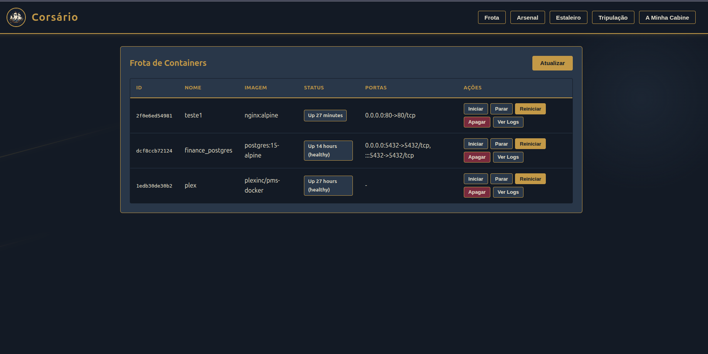
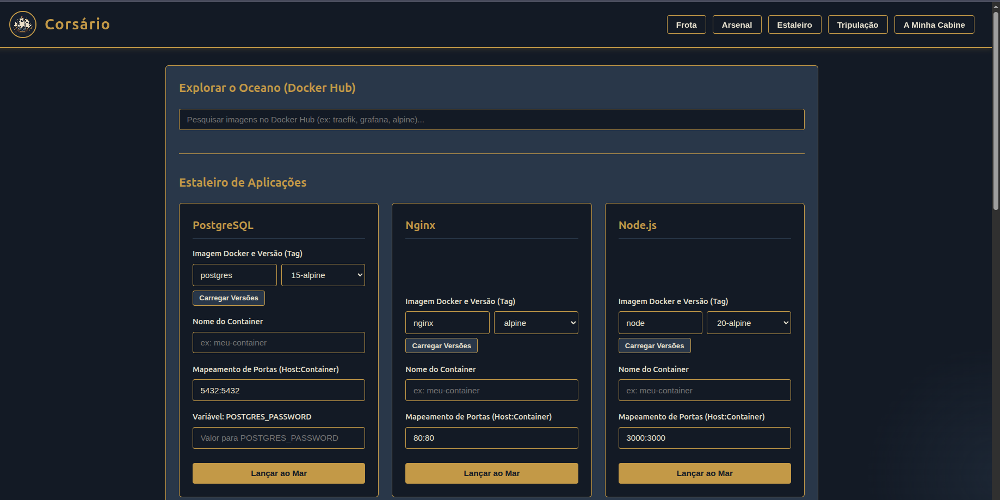
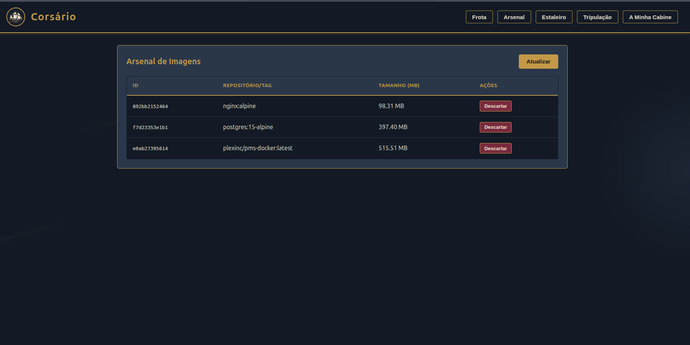
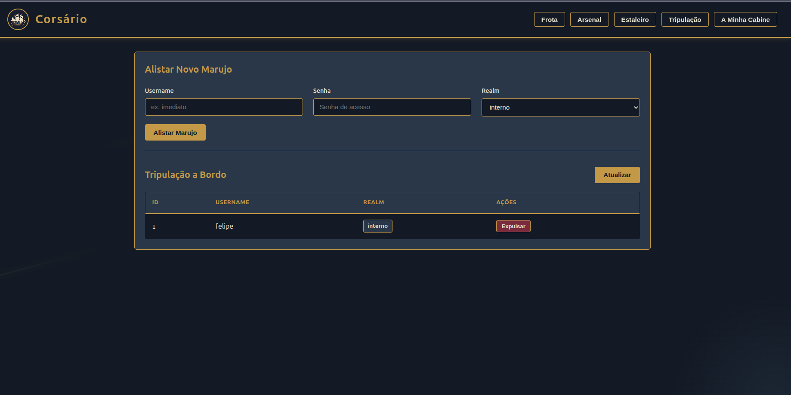
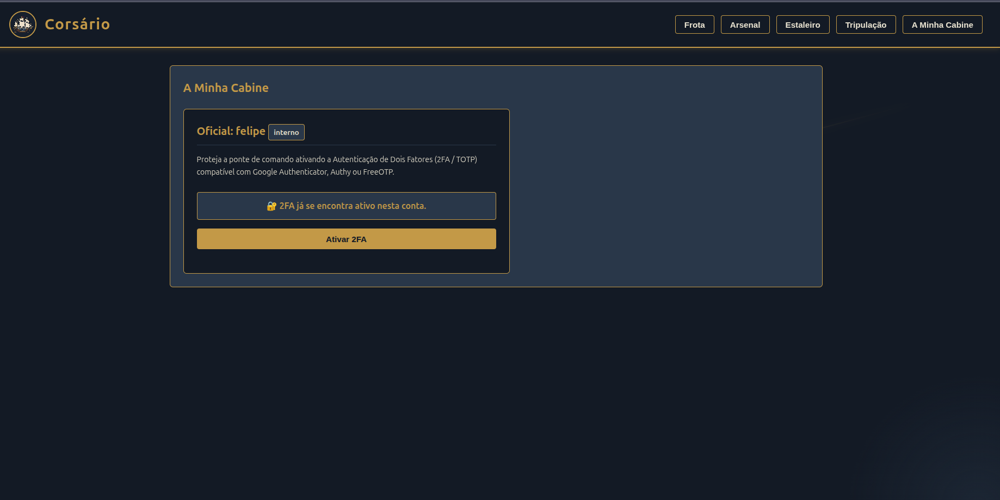

# ⚓ Corsário

<p align="center"></p>

**Corsário** é um painel web ultraleve, distribuído em um único binário Go com arquivos embutidos (`embed.FS`), projetado para gerenciar frotas de containers Docker diretamente através do socket nativo (`/var/run/docker.sock`), sem desperdício de recursos e com uma experiência visual de inspiração marítima.

---

## 🧭 Funcionalidades Principais

- **Gerenciamento Completo da Frota (Containers):** Listagem de containers ativos e inativos, visualização de portas e ações imediatas de ciclo de vida (**Iniciar**, **Parar**, **Reiniciar** e **Apagar**) sem recarregamento de página via HTMX.
- **Luneta de Logs em Tempo Real (SSE):** Streaming contínuo das últimas linhas de log (`stdout`/`stderr`) de qualquer container diretamente na tela do navegador utilizando **Server-Sent Events (SSE)**.
- **Arsenal de Imagens:** Inspeção das imagens Docker armazenadas localmente com tamanho em MB e descarte forçado de imagens obsoletas.
- **Estaleiro de Aplicações + Docker Hub:**
  - Catálogo pré-configurado com templates prontos para lançamento rápido (*PostgreSQL, Nginx, Node.js, Redis, MySQL, MongoDB, WordPress, Zabbix e Wazuh*).
  - Integração direta com a API do **Docker Hub** para busca de imagens em tempo real e carregamento dinâmico de versões (`tags`).
- **Segurança & Tripulação (Auth + 2FA/TOTP):**
  - Banco de dados **SQLite em modo WAL** dedicado ao gerenciamento de usuários e sessões.
  - Criação de administrador via CLI e gerenciamento completo da tripulação pela interface.
  - Autenticação de Dois Fatores (**2FA / TOTP** compatível com RFC 6238) com geração integrada de QR Code em *A Minha Cabine*.

---

## 📸 Capturas de Tela

### Frota — Visão Geral do Painel


### Estaleiro — Catálogo de Aplicações


### Arsenal — Gerenciamento de Imagens


### Tripulação — Gestão de Usuários


### Minha Cabine — Configuração de 2FA


---

## ⚡ Início Rápido (Instalação Rápida)

Em qualquer servidor Linux com Docker e `systemd`, execute o comando de linha única abaixo como `root` (ou via `sudo`):

```bash
curl -sSL https://raw.githubusercontent.com/felipests0/corsario/main/install.sh | sudo bash
```

Após a instalação, crie o seu primeiro usuário Capitão (administrador):

```bash
sudo /usr/local/bin/corsario -create-admin capitao -password "SuaSenhaForteAqui"
```

Em seguida, acesse o painel no navegador através da porta `9443`:
- `http://<IP-DO-SERVIDOR>:9443` (ou `https://<IP-DO-SERVIDOR>:9443`)

---

## 🛠️ Instalação Manual / Desenvolvimento

### Pré-requisitos
- **Go** `1.22+` (com suporte a `CGO_ENABLED=1` e `gcc` para o driver SQLite)
- **Docker** instalado e em execução (`/var/run/docker.sock`)

### Compilando a partir do código-fonte

```bash
# 1. Clone o repositório
git clone https://github.com/felipests0/corsario.git
cd corsario

# 2. Baixe as dependências e compile o arquivo binário único
CGO_ENABLED=1 go build -ldflags="-s -w" -o corsario ./cmd/corsario

# 3. Crie o usuário administrador inicial
./corsario -create-admin admin -password "admin123"

# 4. Inicie o servidor na porta 9443
./corsario
```

### Executando os Testes Automatizados

```bash
go test -v ./...
```

---

## 🎨 Identidade Visual (Paleta Corsário)

| Elemento | Hexadecimal | Descrição |
| :--- | :--- | :--- |
| **Fundo Principal** | `#0B1320` | Azul-marinho profundo |
| **Elementos Secundários** | `#243447` | Azul aço |
| **Destaque / Ações** | `#C49A45` | Dourado envelhecido |
| **Texto e Ícones** | `#E8E2D0` | Marfim |
| **Alertas / Detalhes** | `#7A263A` | Vermelho vinho |

---

## 📄 Licença

Distribuído sob a licença MIT.
